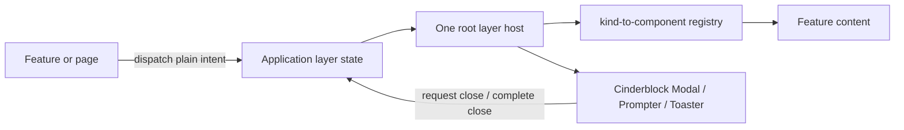

# Global layer state integration

Use serializable intent descriptors for application-wide modals, prompts,
dropdowns, and toasts. Materialize their React content in one host near the
application root.

Cinderblock remains state-management agnostic: it owns presentation,
animation, focus, keyboard behavior, and lifecycle callbacks. The consuming
application owns which layers are active, how they interact, and what product
content they render.

## The short version

- Keep a layer local when one mounted component owns its trigger, content, and
  close behavior.
- Use a global host when distant features can open the layer, it must
  coordinate with other layers, or it can outlive its trigger component.
- Store plain `{id, kind, payload, phase}` descriptions globally.
- Do not store React elements, component instances, refs, promises, or
  callbacks in Redux or another global state container.
- Let the root host map each `kind` to a feature component.
- Model closing as a phase so exit animation can finish before the record is
  removed.
- Keep product-specific coexistence and queue rules in the application, not
  Cinderblock.

## Choose the narrowest appropriate owner

| Situation | Recommended owner |
|---|---|
| One component opens and closes a simple modal | Local React state |
| One page owns a search field or expanded panel | Page state |
| A prompt can be requested from distant features | Global descriptor state |
| Confirmations must wait behind one another | Global FIFO queue |
| A modal must close dropdowns or block another modal | Global layer coordinator |
| Several components can publish transient status | Global toast host |

Global state should solve an ownership or coordination problem. It should not
be the default location for every `visible` boolean.

## Architecture



The registry is the boundary between serializable application state and
composed React content.

## Descriptor shape

Use a discriminated union so each `kind` determines its valid payload:

```ts
type LayerPhase = 'open' | 'closing';

type ModalDescriptor =
  | {
      id: string;
      kind: 'edit-record';
      phase: LayerPhase;
      dismissible: true;
      payload: {
        recordId: string;
        returnFocusId: string;
      };
    }
  | {
      id: string;
      kind: 'review-consent';
      phase: LayerPhase;
      dismissible: false;
      payload: {
        consentId: string;
        returnFocusId: string;
      };
    };
```

Prefer stable record and focus-target IDs over copied domain objects. Include
only values needed to identify and coordinate the requested task.

An ID is not automatically public or harmless. Treat identifiers according to
the sensitivity of the records they address, disable production debugging
tools when appropriate, and never put credentials, access tokens, or secrets
in UI state.

## Dispatch intent, not presentation

Feature code describes the requested task:

```ts
dispatch(openModal({
  id: `edit-record-${recordId}`,
  kind: 'edit-record',
  phase: 'open',
  dismissible: true,
  payload: {
    recordId,
    returnFocusId: `edit-record-button-${recordId}`
  }
}));
```

Avoid this in a global store:

```tsx
dispatch(openModal(<EditRecord record={record} onSave={saveRecord} />));
```

React elements and callbacks make state harder to inspect, test, replay,
persist, and coordinate. Captured callbacks can also retain page state from
the moment the layer opened.

## Materialize content at the root

The root host reads a descriptor and resolves its `kind` outside global state:

```tsx
function renderModal(
  descriptor: ModalDescriptor,
  context: { headingId: string; requestClose: () => void }
) {
  switch (descriptor.kind) {
    case 'edit-record':
      return (
        <EditRecordDialog
          recordId={descriptor.payload.recordId}
          headingId={context.headingId}
          onRequestClose={context.requestClose}
        />
      );
    case 'review-consent':
      return (
        <ReviewConsentDialog
          consentId={descriptor.payload.consentId}
          headingId={context.headingId}
          onRequestClose={context.requestClose}
        />
      );
  }
}
```

Mount the host once, below the application's providers:

```tsx
<Provider store={store}>
  <App />
  <UiLayerHost renderModal={renderModal} />
</Provider>
```

The feature component resolves current domain data using the descriptor's IDs.
Server mutations must still authorize those IDs; the descriptor is UI intent,
not proof of permission.

## Preserve the close lifecycle

Do not remove a layer as soon as dismissal is requested:

```text
open → closing → removed
```

1. `onRequestClose` changes the matching record to `phase: 'closing'`.
2. The host passes `visible={phase === 'open'}` to Cinderblock.
3. Cinderblock runs its exit animation and restores background behavior.
4. `onCompleteClose` removes that exact record.
5. The host restores focus to `returnFocusId` when feature-specific focus
   restoration is needed.

Match completion actions by stable ID. A stale animation callback must not
remove a newer layer that happens to use the same host.

## Define conflict rules explicitly

Applications should document a layer policy rather than relying on render
order and `z-index`:

- Opening a dropdown closes the current dropdown.
- Opening a blocking modal or prompt closes dropdowns.
- Only one modal task is interactive at a time.
- Prompts form a FIFO queue.
- A prompt requested by a modal waits until the modal finishes closing, unless
  it is intentionally part of that same modal task.
- Toasts may coexist with blocking layers but must not cover their actions.
- Escape affects only the topmost dismissible layer.
- Route changes close non-persistent layers.
- Resize or orientation changes close positioned dropdowns, but should not
  silently discard a modal task.

These are reasonable defaults, not Cinderblock requirements. Different
products can implement different policies while using the same components.

## Accessibility responsibilities

Cinderblock provides the reusable interaction mechanics. The application
still supplies task-specific meaning:

- Give every modal or prompt an accessible name through
  `accessibilityLabel` or `aria-labelledby`.
- Put the host-provided heading ID on the visible dialog heading.
- Choose an intentional initial focus target when the first control is not the
  right starting point.
- Preserve an opener or `returnFocusId`.
- Require activation of an explicit control for destructive confirmation.
- Keep important results in persistent page content; do not rely only on a
  transient toast.

Verify focus entry, containment, dismissal, restoration, reduced motion, and
narrow-screen behavior in the completed feature.

## Redux Toolkit is optional

Redux Toolkit is a good fit when an application already needs global
coordination, typed transitions, developer inspection, or queued events. React
Context or another state library can use the same architecture.

The important boundary is not Redux itself. It is:

```text
serializable intent → application registry → Cinderblock component
```

Keep descriptors serializable even when the chosen state library does not
enforce serializability automatically.

## Relationship to StarterKit

StarterKit established the useful root-host pattern: Redux-connected adapters
select global UI records and pass ordinary props into state-agnostic
Cinderblock components.

For new projects, preserve that separation while modernizing the data
boundary:

- keep the single root host;
- keep Cinderblock unaware of Redux;
- replace stored React `content` elements with typed descriptors;
- replace implicit overlapping flags with explicit conflict rules; and
- use a registry to create React content outside the store.

Existing StarterKit screens do not need an immediate rewrite solely to adopt
this guide. Apply the descriptor pattern when adding a new global layer or
when existing layer state becomes difficult to inspect or coordinate.

## Adoption checklist

- [ ] Local state was considered before adding global state.
- [ ] Every global record is serializable.
- [ ] Descriptor unions constrain valid `kind` and `payload` combinations.
- [ ] Unnecessary sensitive/domain content, rendered elements, callbacks,
      refs, and secrets remain outside the store.
- [ ] One root host maps descriptors to feature components.
- [ ] Open, closing, and removal are separate lifecycle events.
- [ ] Prompt ordering and layer coexistence rules are documented and tested.
- [ ] Route and resize cleanup behavior is explicit.
- [ ] Dialog headings, initial focus, and return focus are wired.
- [ ] Server-side authorization does not trust UI descriptor IDs.
- [ ] Production debugging and logging match the application's data
      sensitivity.

Shapeup's `src/store/uiLayers.ts` and
`src/components/ui/UiLayerHost.tsx` are the first application reference for
this strategy.
